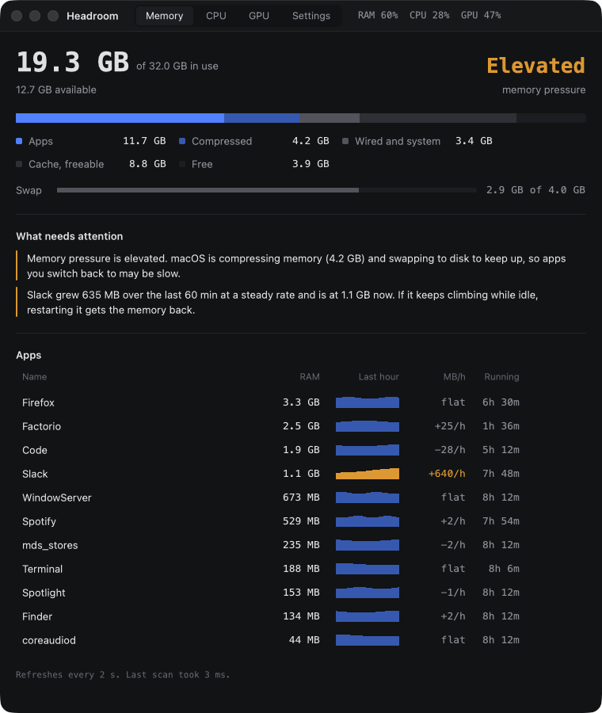
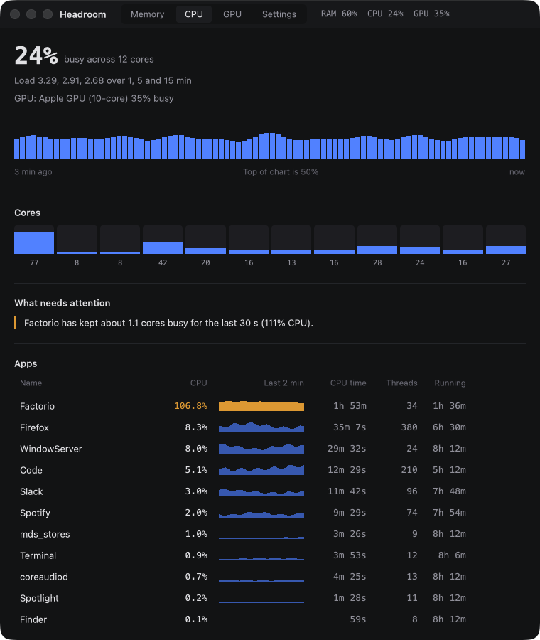
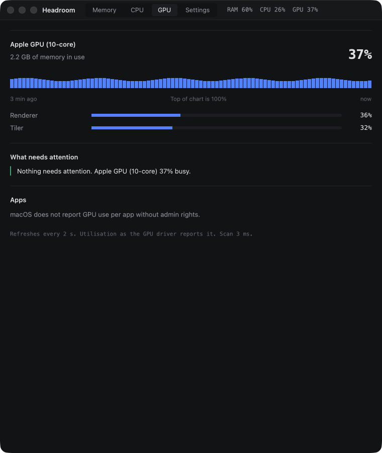
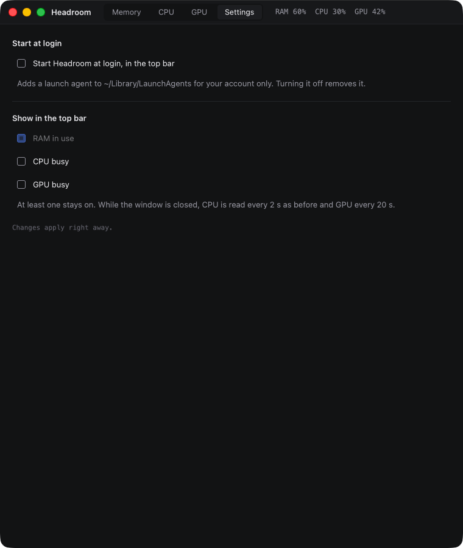

# Headroom

A small, fast system monitor for Linux and macOS, written in Rust with
[gpui](https://www.gpui.rs/). It sits in the top bar as a RAM percentage and opens a window
that shows where your RAM, CPU and GPU go, and on Linux why the system is killing your apps.

It is built to be left running: on Linux about 0.05% CPU in the tray and around 1% with the
window open.



| CPU | GPU | Settings |
|---|---|---|
|  |  |  |

The screenshots are the macOS build in demo mode (`headroom --demo`), which shows a simulated
machine, so nothing in them comes from a real computer.

## What it shows

This is the Linux layout. The [macOS](#macos) section lists what differs there.

- **Top bar**: the % of RAM used, with a bar under it that turns green, amber or red with
  memory pressure. Click it to open the window. It needs GNOME's AppIndicator extension,
  which is on by default in Ubuntu.
- **Memory tab**
  - **Header**: RAM in use, and memory pressure next to the systemd-oomd kill limit.
  - **Where it goes**: a stacked bar split into apps, GPU and shared memory, /tmp in RAM,
    kernel, freeable cache and free, plus a swap bar.
  - **Why**: warnings in plain language.
  - **Apps**: RAM, swap, GPU buffers and a 1-hour trend for each app. The trend shows
    growth in MB/h, which is how you spot a leak. Each row also has uptime and a two-click
    Quit button.
  - **Kills**: every out-of-memory kill from the last 7 days, by systemd-oomd or the kernel.
- **CPU tab**: total CPU, load average, package temperature and clock speed; a 3-minute
  history; a meter per core; warnings for heat, CPU pressure and an app pinning cores; and
  per-app CPU (100% is one full core) with a 2-minute trend, CPU time, threads, uptime and
  Quit. Each app also gets a GPU column for its busiest GPU.
- **GPU tab**: for each GPU, busy %, each engine (render, copy, video) and clock, and for
  NVIDIA also VRAM, temperature and power; a 3-minute history; and per-app busy % on each
  GPU plus graphics memory.
- **Board sensors** (Dell laptops): the temperature beside the memory slots, the CPU fan,
  and the temperature and fan beside the discrete GPU. Other machines simply don't show
  these.
- **Notifications**: when pressure reaches 60% of the oomd limit, and whenever something is
  killed for memory.

Data is sampled every 2 seconds. Between samples, numbers, bars and rows ease to their new
values in about a third of a second and the charts slide one slot. Frames are only drawn
while something is moving.

## Settings

The Settings segment next to the tabs (or `headroom --settings`) has two things:

- **Start at login**: starts Headroom in the top bar when you log in. On Linux it writes
  `~/.config/autostart/headroom.desktop`; on macOS it adds a launch agent for your account
  only. Turning it off removes the file again.
- **Show in the top bar**: RAM, CPU and GPU, in any combination, with RAM only by default.
  With the window closed, CPU is read every 2 s and GPU every 20 s, so showing them costs
  nothing measurable.

Choices are saved in `~/.config/headroom/settings` and apply right away.

## macOS

Headroom runs on Apple Silicon and builds with only the Command Line Tools; Xcode is not
needed, because gpui's shaders are compiled at launch.

- **Menu bar item** in place of the tray icon: the chosen values as text, with a menu to
  open the window or quit. `headroom --tray` starts with just the menu bar item.
- **Memory**: RAM in use and the kernel's memory pressure level (Normal, Elevated,
  Critical), a breakdown into apps, compressed, wired and system, freeable cache and free,
  swap, and RAM per app with the 1-hour trend. Helper processes are grouped under their
  app. Processes owned by other users are skipped.
- **CPU**: total, load average, a meter per core and per-app CPU, threads and CPU time.
- **GPU**: how busy the Apple GPU is (overall, renderer and tiler) and the memory it uses.

Not available on macOS, because there is no public source for them: the out-of-memory kill
history and kill limit, CPU temperature and clock speed, GPU temperature and power, and
per-app swap and GPU use. Those parts of the window are hidden. The accessibility tree and
the board sensors are Linux only.

Measured on an M1 with 16 GB on 11 November 2026:

| | CPU |
|---|---|
| Menu bar only | about 0.3% |
| Window open, Memory tab | about 1.7% |
| Window open, CPU tab | about 2.3% |
| Window open, GPU tab | about 0.9% |

That is higher than on Linux. gpui keeps a display link running while a window is visible,
which costs about 1% on its own, and the per-app sparklines on the CPU tab are drawn as
many small bars. The numbers ease at 30 frames a second on macOS to keep this down.

## Demo mode

`headroom --demo` fills every tab with a simulated machine and a fixed cast of apps. It
reads nothing from the system, saves no settings, sends no notifications and never signals
a process, and it runs next to a real copy without getting in its way. It exists so that
screenshots and recordings never show a real computer. `headroom --demo --dump` prints the
simulated report.

## Cost

Measured on Linux on 10 and 11 November 2026, on a laptop running about 575 processes.

| | CPU | Wake-ups | Own RAM |
|---|---|---|---|
| In the tray | 0.05% | about 5/s | 30 MB |
| Window open | about 1.3% | about 65/s | 38 MB |

Measured again after the easing was tuned: about 0.6% CPU on the Memory tab, 1.1% on the
CPU tab and 0.7% on the GPU tab.

With the window open, about 60 of those wake-ups per second come from gpui's Wayland frame
loop: it requests a frame callback every refresh and skips drawing when nothing changed.
GNOME stops sending those callbacks while the window is minimized or hidden.

With the GPU already busy (an animated wallpaper running, load average about 7) the open
window measured 4.8%: 3.6% on the drawing thread and 0.4% on the board-sensor thread.

### How it stays cheap

- **Refresh rate:** memory and pressure are read every 2 s (0.06 ms). A full process scan
  (about 6 ms) runs every 2 s with the window open, every 20 s in the tray, and every 2 s
  while pressure is building.
- **Process scan:** it reads `/proc/PID/status` only. App names and start times are cached
  per process, and the process name catches a pid being reused. It doesn't use
  `smaps_rollup`, which walks page tables and is 6x slower on Electron apps.
- **Per-app CPU and GPU:** only measured while the CPU tab is showing, which adds about
  1.3 ms per scan.
- **GPU memory:** finding every process with the GPU open (17 ms) runs once a minute. In
  between, only those processes' `fdinfo` is re-read (1.7 ms).
- **NVIDIA:** queried through NVML only while the card is awake (`power/runtime_status` is
  `active`), because querying a suspended discrete GPU wakes it up. A sleeping card shows
  as "asleep". Intel and other DRM drivers are read from the per-client engine counters in
  `/proc/PID/fdinfo`.
- **Board sensors:** a fresh firmware read takes 70 to 80 ms, so a background thread reads
  them every 10 s, and only while the window is open (about 0.3% CPU). They come from
  `dell_ddv`, so they keep working while the NVIDIA card sleeps. `dell_smm` offers the same
  values through SMM calls that briefly stall every core, so it isn't used.
- **Kills:** the 7-day history loads once at startup. After that, one `journalctl -f`
  process (1 MB) blocks until systemd-oomd or the kernel logs something, so new kills
  appear at once.
- **Tray icon:** it is sent over D-Bus only when the percentage, colour or tooltip changes.
- **Easing:** it stops as soon as the rest of a move would be under half a pixel or half a
  unit. An earlier, tighter threshold kept the window drawing for 1.3 s of every 2 s and
  cost about 6% CPU.
- **Tray clicks and second launches:** they arrive on a channel the app waits on, with no
  polling.

`headroom --bench` prints the per-part timings on your machine.

## Install

On macOS, with Rust installed:

```bash
git clone https://github.com/bernisnukic/headroom
cd headroom
cargo build --release
./target/release/headroom
```

On Linux:

```bash
git clone https://github.com/bernisnukic/headroom
cd headroom
./install.sh --autostart
```

`install.sh` builds with cargo, installs `~/.local/bin/headroom` and a launcher entry, and
with `--autostart` also starts Headroom in the tray at login. It lists any missing build
packages with the `apt install` line to fix them.

To build by hand:

```bash
cargo build --release && cp target/release/headroom ~/.local/bin/
```

gpui needs these packages at build time (Ubuntu and Debian names): `libxkbcommon-dev`,
`libwayland-dev`, `libvulkan-dev`, `libfontconfig-dev`, `libxcb1-dev` and `pkg-config`.

Without a Dell laptop the board temperatures and fans just don't appear, and without an
NVIDIA card the GPU tab shows only the integrated GPU.

## Usage

```bash
headroom            # open the window
headroom --tray &   # start in the top bar
headroom --cpu      # open on the CPU tab, or switch a running copy to it
headroom --gpu      # the same for the GPU tab
headroom --settings # the same for Settings
headroom --dump     # print the same report in the terminal
headroom --bench    # print how long each part of a refresh takes
headroom --demo     # show a simulated machine instead of this one
```

Headroom is single-instance: a second launch opens the window of the copy that is already
running.

## Accessibility

gpui 0.2.2 has no accessibility support, so `src/a11y.rs` publishes Headroom's own AT-SPI
tree through AccessKit. Screen readers and automation tools can read every number, switch
tabs and press Quit.

- The tree is rebuilt only while the window is open, or when an assistive client first
  connects.
- In the tray, the tree reflects the cheap tray refresh. Per-app CPU and clock speed appear
  once the window is open.
- AccessKit normally joins the accessibility bus only when GNOME reports accessibility as
  enabled. That setting would make every Chromium and Electron app build a tree too, so
  `vendor/accesskit_unix` is patched to join regardless, the way GTK apps do.

## Local workarounds in this repo

- `vendor/xattr`: gpui 0.2.2 pulls in `xattr 0.2.3`, which uses `libc::ENOATTR`. libc
  0.2.19x removed it, so it's patched to `ENODATA`, the same value on Linux.
- `vendor/accesskit_unix`: joins the accessibility bus even when GNOME reports
  accessibility as off (see above).
- `linklibs/` and `.cargo/config.toml`: a symlink for `libxkbcommon-x11.so`, for machines
  where `libxkbcommon-x11-dev` isn't installed. Installing that package makes it
  unnecessary.

## Files it installs

- `~/.local/bin/headroom`: the binary
- `~/.local/share/applications/headroom.desktop`: the launcher entry
- `~/.config/autostart/headroom.desktop`: optional, starts it in the tray at login
- `$XDG_RUNTIME_DIR/headroom.sock`: makes it single-instance

## License

MIT, see [LICENSE](LICENSE). The crates under `vendor/` are patched copies of
[xattr](https://github.com/Stebalien/xattr) and
[accesskit_unix](https://github.com/AccessKit/accesskit) and stay under their own
MIT or Apache-2.0 licenses.
